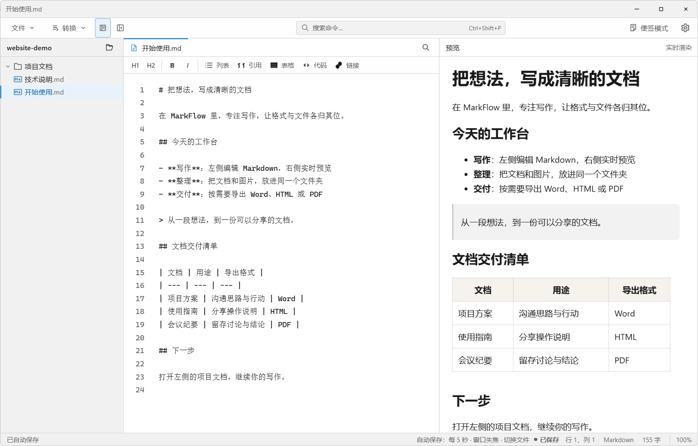
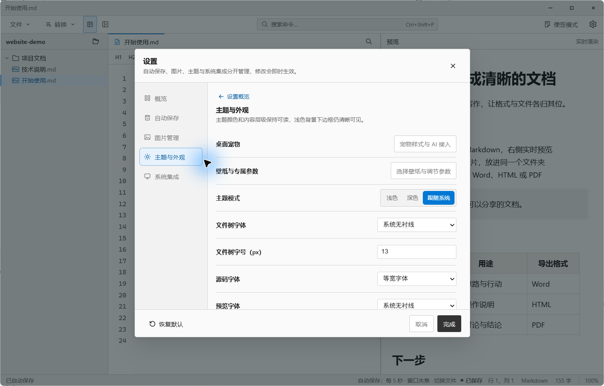
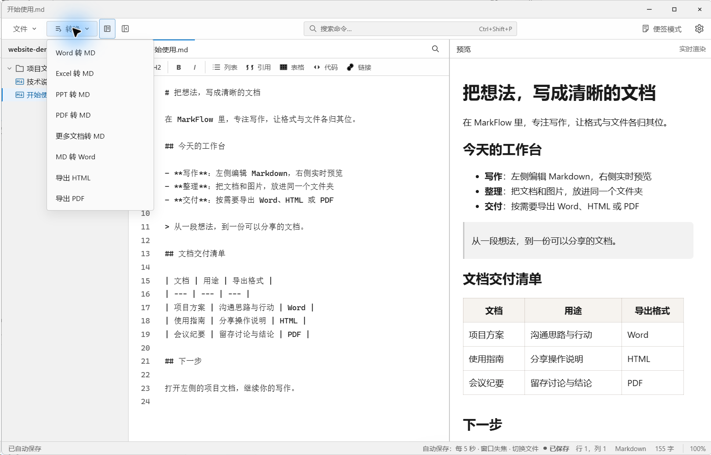

<div align="center">


# MarkFlow

本地优先的 Markdown 文档转换、编辑与文件夹工作台

Markdown、Word、Excel、HTML、PDF 的转换、编辑、预览和文件夹管理都在一个桌面应用中完成。

[](https://github.com/PanJitao/MarkFlow/releases/latest)


[](LICENSE)

[官网](https://markflow.wuhupan.top/) · [下载最新版本](https://github.com/PanJitao/MarkFlow/releases/latest) · [宠物 MCP](https://markflow.wuhupan.top/mcp/) · [核心功能](#核心功能) · [使用方式](#使用方式) · [自行构建](#自行构建)

</div>

---

## 项目简介

MarkFlow 面向日常写作、文档整理和格式转换。它提供 Markdown 源码编辑与实时预览，支持 Word、Excel 导入为 Markdown，并将 Markdown 导出为 Word、HTML 或 PDF。打开文件夹后，可在左侧文件树中浏览 Markdown 和图片资源。

当前源码版本为 `0.4.5`。转换、预览、外观设置和文件夹操作均在本机完成，文档不会上传到服务端。

## 截图

### 文件夹工作区与实时预览



### 设置概览



### 转换菜单



## 核心功能

### 文件夹工作区

- 通过“文件 -> 打开文件夹”载入工作区，左侧文件树按需展开，避免扫描整个目录。
- 文件树可收起、展开、左右拖拽调整宽度，宽度会保存在本机。
- 在文件树中点击 Markdown 文件即可打开；点击图片可将相对于当前 Markdown 文件的路径插入编辑器。
- “最近打开的文件夹”以右侧二级菜单显示，靠近窗口边缘时自动向左展开。
- 文件菜单支持新建文件、新建文件夹、新建窗口、打开文件、打开文件夹、保存和另存为。
- 文件树上下文菜单支持重命名、在文件管理器打开、删除到系统回收站、新建文件/文件夹、复制路径和复制相对路径。

### Markdown 编辑与预览

- Markdown 源码编辑与实时预览并排显示，编辑区可独立隐藏。
- 编辑区与预览区上下滚动同步，中间分隔条可调整两区宽度。
- 列表和引用按 Enter 自动续写当前层级；空标记行再次按 Enter 可退出结构。
- 工具栏支持标题、加粗、斜体、列表、引用、表格、代码块和链接。
- 支持全局撤回，编辑区、格式工具和预览表格修改均可使用 `Ctrl/Command + Z`。
- 自动恢复上次编辑内容、当前文件与界面布局：窗口位置和尺寸、编辑区/文件树显隐、文件树展开状态、分栏比例都会在重启后还原；「新建窗口」则打开空白编辑窗口。

### 表格、代码块与上下文菜单

- 预览表格可直接编辑单元格，悬停表格边界可新增或删除行、列；双击单元格可选中该单元格内容。
- 代码块提供行号、JSON 键值高亮和复制图标，支持 Java、Python、JavaScript、Node.js、C、C++、C#、SQL、PowerShell、CMD/BAT、Apex、ABAP 和 Bash 等语法高亮。
- 支持 ```mermaid 图表渲染：思维导图（mindmap）、流程图、时序图、甘特图等，图表配色跟随亮/暗主题切换，语法错误时在图表位置显示具体原因。
- 编辑器上下文菜单提供复制、粘贴、JSON 格式化、插入表格、插入引用、插入图片和多语言代码块。
- JSON 格式化失败时会显示具体行号、列号和解析原因。

### 内容显示与外观

- 支持 `Ctrl/Command + 滚轮`、`Ctrl/Command + +` 和 `Ctrl/Command + -` 缩放编辑与预览内容，范围为 `70% - 180%`。
- 支持 PNG、JPG、WebP、GIF、MP4、WebM 作为静态或动态背景素材，单个文件最大 `100 MB`。
- 可设置背景底色、背景透明度、面板和按钮透明度、代码块背景透明度以及编辑器/预览字体颜色。
- 支持面板、上方菜单栏和下方状态栏分别设置背景模糊；设置会保存在本机。

### 桌面宠物、便签与待办

- 点击顶部“便签模式”，或在命令面板搜索“进入桌面便签模式”。编辑器收起，桌面显示蓝发 Q 版角色与便签面板。
- 内置蓝发角色采用 [dsh-pet](https://github.com/PC2005-cloud/dsh-pet) 的 15 段透明动画素材，项目作者为 [PC2005-cloud](https://github.com/PC2005-cloud)。采用 MIT 许可，保留 `Copyright (c) 2026 PC2005-cloud`；原始许可、素材来源与版本随安装包保留。待机时自然衔接呼吸、张望和日常小动作；单击互动，双击或点击下方“便签”打开面板，拖动移动位置，右键或“···”选择动作。
- 动作菜单可挥手、伸懒腰、玩魔方和睡觉；拖动时播放悬空动作，完成待办时播放庆祝。睡觉不会屏蔽待办，到点会唤醒并提醒。气泡话语为内置提示。
- 便签自动保存，支持米白、薄荷、淡粉、浅紫四种颜色。待办可设置本地日期和时间，并多选准时、提前 15 / 30 / 60 分钟或自定义分钟数。
- 提醒以宠物气泡显示，可直接完成、延后 10 分钟、收起或切换其他提醒。关闭编辑器与便签面板后，宠物和提醒仍继续运行；系统托盘可重新打开窗口。
- 从宠物菜单选择“退出软件”会保存内容并结束程序；完全退出或关机期间无法实时提醒，下次启动会合并补发错过的提醒。未提交的待办表单保留为草稿。
- “关闭便签模式”停止宠物提醒并返回编辑器，不删除便签和待办。启用状态、待办、便签、提醒记录和宠物位置保存在应用数据目录的 `desktop-notes.json`；仅一个 MarkFlow 进程负责该数据和提醒。
- Windows 使用原始 VP9-alpha WebM，macOS WKWebView 使用保留透明通道的动画 WebP，避免 VP9 解码丢失透明度；切换动作时，下一段就绪后才移除上一段。系统开启“减少动态效果”时显示静态角色。
- 安装包按目标平台只携带一套内置动画：Windows 不再打入约 59.61 MB 的 Mac WebP，Mac 不再打入 WebM；15 个动作与授权文件均保留。Windows 视频无法解码时回退到静态封面。自定义宠物包仍支持两种格式。`npm run test:pet-bundle` 可检查构建产物的素材引用与体积。
- Windows 已进行桌面实测；macOS 已适配透明窗口和平台字体，仍需 Mac 真机验证。透明宠物使用 Tauri 的 macOS private API 配置，面向直接安装包分发。素材可用 `node scripts/prepare-pet-assets.mjs <dsh-pet 仓库路径>` 重新准备（需要 FFmpeg）。
- 在「设置 → 主题与外观 → 宠物样式与 AI 接入」或宠物右键菜单导入自己的图片／动画包，独立调整每只宠物的大小、透明度、速度、镜像、气泡和文案。内置本机 stdio MCP，可让外部 AI 获取生成规范、安装素材、切换角色、播放动作和说话；使用时开启 MCP 控制并保持软件运行。见 [宠物包与 MCP 接入说明](docs/pet-customization.md)。

### 文档转换

所有转换均在本机执行，不上传文档内容。

| 转换方向 | 说明 |
| --- | --- |
| Word / Excel / PPT / PDF 等 -> Markdown | 由 Rust 端 anydoc 引擎导入，保留标题、列表、表格、合并单元格和图片（可外置到资源目录）。 |
| Markdown -> Word | 生成真实 `.docx`，支持标题、列表、表格、代码块、链接和嵌套文本格式。 |
| Markdown -> HTML | 导出带基础排版、图片引用和代码块样式的独立 HTML 文档。 |
| Markdown -> PDF | 打开系统打印窗口，可将预览区内容保存为 PDF。 |

### 图片与资源管理

- Word 转 Markdown 时将图片写入独立资源目录，Markdown 仅保存相对路径，避免把图片 Base64 写入正文。
- 打开文件夹时自动使用该工作区的 `img` 目录；单独打开 Markdown 时使用设置中配置的“无项目图片存储位置”。
- 支持图片粘贴、拖拽、导入、直接引用本地路径和 HTML 导出；已命名图片保留原文件名。
- 删除 Markdown 文件时，其对应的引用图片资源目录一并移入系统回收站；重命名图片前会提示风险，不会自动扫描并修改整个工作区的引用。
- 大文档转换会优先外置图片资源，降低打开和渲染时的内存占用。

### 桌面集成

- 可将 MarkFlow 加入 `.md` 文件的“打开方式”，并注册系统文件管理器“新建 Markdown 文档”菜单。
- 可跳转至系统默认应用设置，将 MarkFlow 设置为 Markdown 默认程序。
- 双击 `.md` 文件或通过系统上下文菜单打开时，文档会直接载入编辑区，窗口标题显示文件名。

## 下载与使用

前往 [GitHub Releases](https://github.com/PanJitao/MarkFlow/releases/latest) 下载对应平台的安装包。

| 平台 | 文件名格式 |
| --- | --- |
| Windows x64 | `MarkFlow_<version>_x64-setup.exe` |
| macOS Apple Silicon | `MarkFlow_<version>_aarch64.dmg` |
| macOS Intel | `MarkFlow_<version>_x64.dmg` |

Windows 10/11 通常已内置 WebView2。少数旧系统如缺少该运行时，可从 [Microsoft Edge WebView2](https://developer.microsoft.com/microsoft-edge/webview2/) 安装。

## 使用方式

1. 选择“文件 -> 打开文件夹”，在左侧文件树中打开或新建 Markdown 文件。
2. 在编辑区输入或粘贴 Markdown，右侧即时查看渲染结果。
3. 使用编辑器上下文菜单中的“插入图片”或点击文件树中的图片，插入可随文件夹移动的相对路径。
4. 使用“转换”菜单导入 Word、Excel，或将 Markdown 导出为 Word、HTML、PDF。
5. 使用“设置 -> 外观设置”调整背景、透明度、字体颜色和模糊效果。

## 快捷键

界面按系统显示快捷键：Windows 使用 `Ctrl`，macOS 使用 `⌘`。命令面板可搜索文件、转换、视图和编辑操作；设置输入框内的撤回保留原生行为，不修改文档。

| 快捷键 | 功能 |
| --- | --- |
| `Ctrl/Command + Shift + P` 或 `F1` | 搜索并执行命令；方向键选择、Enter 执行、Esc 关闭 |
| `Ctrl/Command + O` | 打开 Markdown 文件 |
| `Ctrl/Command + N` | 在当前文件夹中新建文件 |
| `Ctrl/Command + Shift + N` | 新建独立窗口 |
| `Ctrl/Command + Shift + S` | 另存为 |
| `Ctrl/Command + F` | 当前文档查找；Enter / Shift+Enter 切换结果 |
| Windows `Ctrl + H` / macOS `Command + Option + F` | 替换；支持大小写匹配、单次或全部替换 |
| `Ctrl/Command + ,` | 打开设置 |
| `Ctrl/Command + Shift + Z`；Windows 也支持 `Ctrl + Y` | 重做 |
| `Ctrl/Command + B` | 展开或收起左侧文件树 |
| `Ctrl/Command + S` | 保存当前 Markdown 文档 |
| `Ctrl/Command + I` | 斜体 |
| `Ctrl/Command + Z` | 撤回编辑区、工具栏或预览表格修改 |
| `Ctrl/Command + 滚轮` | 放大或缩小内容显示 |
| `Ctrl/Command + +` | 放大内容显示 |
| `Ctrl/Command + -` | 缩小内容显示 |
| `Tab` | 插入两个空格，或为选中行增加缩进 |
| `Shift + Tab` | 减少缩进 |
| `Esc` | 关闭菜单或对话框 |

自动保存可在设置中独立配置 3–10 秒循环，并可按需启用窗口失焦和切换文件前保存。底部状态栏会显示当前策略及“已保存 / 未保存 / 保存中”状态。

## 自行构建

### 环境要求

- Node.js `20` 或更高版本。
- Rust stable 工具链和 Cargo。
- Windows 构建需安装 WebView2 运行时。

### 开发与测试

```bash
# 安装依赖
npm install

# 启动 Tauri 开发应用
npm run tauri -- dev

# 仅启动前端页面，访问 http://127.0.0.1:1420
npm run dev

# 前端生产构建
npm run build

# 转换逻辑冒烟测试
node scripts/smoke-convert.mjs

# Windows/macOS 快捷键、输入法、查找替换和历史回归（隔离 DOM + 内存文件 I/O）
npm run test:workbench
```

### 打包

```bash
# 根据当前系统生成默认安装产物
npm run tauri -- build

# 仅构建 Windows NSIS 安装程序
npm run tauri -- build --bundles nsis
```

Windows NSIS 安装程序输出至：

```text
src-tauri/target/release/bundle/nsis/MarkFlow_0.4.5_x64-setup.exe
```

## 项目结构

```text
├─ index.html                 界面结构
├─ package.json               前端依赖与脚本
├─ docs/screenshots/          README 截图
├─ src/
│  ├─ main.ts                 界面交互、文件工作区、预览和外观控制
│  ├─ style.css               界面、文件树与编辑器样式
│  └─ lib/
│     ├─ appearance.ts         外观设置与背景素材本地存储
│     ├─ convert.ts            Markdown → Word 导出
│     ├─ io.ts                 Tauri 文件读写封装
│     ├─ markdown.ts           Markdown 渲染与 HTML 导出
│     └─ mermaid.ts            Mermaid 图表懒加载与主题渲染
└─ src-tauri/
   ├─ src/main.rs             Rust 文件系统命令、文件关联与外部链接处理
   ├─ icons/                  Windows 与 macOS 应用图标
   └─ tauri.conf.json         窗口、CSP 与打包配置
```

## Windows / macOS 适配与验证范围

- 工作台采用系统 UI 字体；源码编辑区使用 Cascadia Code / SF Mono / Menlo / Consolas，并为中文配置苹方与微软雅黑回退。格式工具栏跟随编辑区，文件名、修改标记和行列位置保持可见。
- macOS 使用原生标题栏和 Tauri 默认应用菜单；Windows 保留自绘窗口按钮。Mac 专用配置限定打包为 `.app` / `.dmg`。
- Finder 文件关联通过 `RunEvent::Opened` 接收文件 URL，每个文档进入独立窗口，避免覆盖已打开的草稿。路径通过 URL API 解码，保留中文、空格和大小写；Mac 不使用 Windows 注册表菜单和 ICO 文件图标设置。
- `.github/workflows/compatibility.yml` 在 PR 或手动运行时验证 Windows x64 与 macOS ARM64 / x64 目标编译，并运行宿主平台 Rust 测试和前端回归；不会发布安装包。新增配置尚需远端执行，不能视为 Mac 实机验证。
- 本机前端构建和模拟两种键盘平台的回归不等同于 WKWebView 测试。发布前需在 Apple Silicon 与 Intel Mac 上确认 Finder 冷启动/运行中打开、多文件、原生复制粘贴与撤回、中文输入法、打印 PDF、图片拖拽、Retina/多显示器恢复。
- 当前发布工作流提供 Tauri 更新包签名，尚未配置 Apple Developer ID 签名与公证。macOS 安装包作为预览构建提供，仍需真机完成 Finder、中文输入法、打印和透明宠物的验证；未确定旧版 macOS 的最低支持范围。

交互参考：[VS Code 用户界面](https://code.visualstudio.com/docs/editing/getting-started/userinterface)、[VS Code 快捷键](https://code.visualstudio.com/docs/configure/keybindings)；文件关联实现参考 [Tauri 官方示例](https://github.com/tauri-apps/tauri/blob/dev/examples/file-associations/src-tauri/src/main.rs)。

## Wallpaper Engine 壁纸与专属参数

- 唯一入口为「设置 → 主题与外观 → 选择壁纸与调节参数」。自动发现 Steam 主库及其他磁盘的库，也可选择 Wallpaper Engine 安装目录、`431960` 创意工坊目录、单个项目或本地媒体目录；递归发现嵌套项目并去重。
- 支持图片和 MP4 / WebM / M4V 视频；通过 WebWallGL 3.0 加载场景（包括 scene.pkg）和网页壁纸。按名称搜索、类型筛选；应用程序壁纸保留在列表中并显示不可用原因，不执行 EXE，也不会把封面当作完整壁纸。
- 依据各项目 `general.properties` 动态生成开关、滑块和数值、颜色与 HEX、下拉选项、文本输入及分组，读取排序、步长和条件显示。参数可搜索、实时修改、按项目保存和恢复默认，重启后恢复。文件、目录和场景纹理替换目前只读；复杂脚本、特效、依赖远程资源的网页、系统音频及媒体信息接口并非全部兼容。
- 提供清晰、柔和、通透三种面板预设；「主题与外观」中可调整透明度、模糊、暗化和视频暂停。默认窗口失焦或隐藏时暂停视频。
- 桌面版保存原媒体路径，不复制整个视频；重启后恢复背景。原文件移动或被 Steam 清理后，需要重新选择。视频能否解码取决于系统 WebView，优先使用 H.264 MP4。
- 本地上传与壁纸库共用唯一的当前背景：最后一次成功选择覆盖旧背景，清除旧上传 Blob、媒体 URL、播放器和选中状态，不删除磁盘原文件。先校验图片/视频能否加载，再保存并替换；加载或保存失败保留原背景。新选择或清除会取消尚未完成的旧加载，重启仅恢复最后保存的背景。
- 仅编辑器界面使用壁纸，导出文档不携带壁纸。本功能不启动 Wallpaper Engine；网页/场景脚本运行在隔离的 iframe 中，不具有编辑器 IPC 和存储访问权，资源访问限于已选项目目录。
- Windows 本机库共识别 53 项（52 项可尝试加载，1 项应用程序不可用），已验证视频、Pac-Man 场景、时钟网页的显示及参数更新。数量代表识别范围，不表示所有复杂场景均已验证。macOS 可手动选择复制过来的项目目录，但尚未完成 Mac 实机验证。
- 参数面板参考 [dsh-wallpaper-engine](https://github.com/elysia395/dsh-wallpaper-engine) 的项目属性机制；渲染使用 [WebWallGL](https://github.com/oneincase/webwallgl)。第三方许可和源码地址随安装包放在 `resources/wallpaper-licenses`。

壁纸扫描与界面检查：`cargo test --manifest-path src-tauri/Cargo.toml`、`node scripts/test-wallpaper.mjs`、`node scripts/test-background.mjs`。

## 技术栈

- 桌面外壳：[Tauri v2](https://tauri.app/) 和 Rust。
- 前端：原生 TypeScript 与 [Vite](https://vitejs.dev/)。
- 办公文档导入（Word/PowerPoint/Excel/ODF/RTF/EPUB/CSV/PDF）：Rust 端 [anydoc](https://crates.io/crates/anydoc) 引擎。
- Word 导出：[docx](https://github.com/dolanmiu/docx)。
- 渲染与清理：[markdown-it](https://github.com/markdown-it/markdown-it)、[highlight.js](https://highlightjs.org/)、[Mermaid](https://mermaid.js.org/) 和 [DOMPurify](https://github.com/cure53/DOMPurify)。

## 许可证

本项目采用 [MIT License](LICENSE) 开源。你可以使用、复制、修改、发布和商用本项目代码，但需保留原始版权和许可声明。

## 项目地址

[https://github.com/PanJitao/MarkFlow](https://github.com/PanJitao/MarkFlow)
